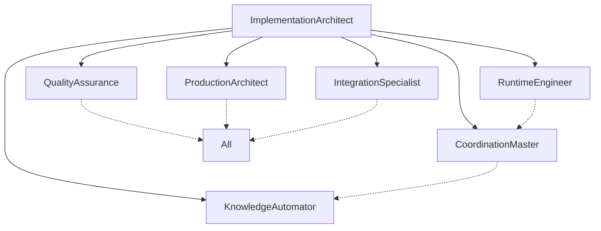

# CollaborativeIntelligence Implementation Plan

**Status**: Active Implementation Phase  
**Timeline**: 12-month roadmap with quarterly milestones  
**Approach**: Agentic Parallelization with Coordinated Development  
**Last Updated**: September 5, 2025

## 🎯 Executive Summary

This implementation plan transforms the CollaborativeIntelligence system from an exceptional research prototype (60% implementation) to a production-ready multi-agent collaboration platform (95%+ implementation). Using agentic parallelization, we'll coordinate multiple specialized development tracks to bridge critical implementation gaps while maintaining architectural integrity.

## 📊 Current State Assessment

### Implementation Gap Analysis
- **Architecture Design**: 90/100 ✅ (Exceptional foundation)
- **Documentation**: 95/100 ✅ (Comprehensive coverage)
- **Agent Organization**: 85/100 ✅ (Strong ecosystem)
- **Runtime Implementation**: 35/100 ❌ (Critical gap)
- **Testing Infrastructure**: 30/100 ❌ (Major gap)
- **Production Readiness**: 45/100 ❌ (Significant gap)

### Priority Implementation Areas
1. **Runtime Execution Engine** - Core system functionality
2. **Agent Coordination System** - Multi-agent orchestration
3. **Automated Knowledge Processing** - BRAIN system automation
4. **Testing & Quality Assurance** - Production reliability
5. **Production Infrastructure** - Deployment and operations

## 🏗️ Agentic Parallelization Strategy

### Development Coordination Model

**Primary Coordination Agent**: **ImplementationArchitect**
- Oversees entire implementation roadmap
- Coordinates cross-team dependencies
- Maintains architectural integrity
- Manages resource allocation and timeline

**Specialized Development Tracks** (6 parallel agents):

1. **RuntimeEngineer** - Core execution systems
2. **CoordinationMaster** - Multi-agent orchestration  
3. **KnowledgeAutomator** - BRAIN system automation
4. **QualityAssurance** - Testing and validation
5. **ProductionArchitect** - Infrastructure and deployment
6. **IntegrationSpecialist** - System integration and APIs

### Coordination Protocol



### Daily Coordination Cycle
1. **Morning Standup** (ImplementationArchitect coordinates)
2. **Parallel Development** (6 specialized tracks)
3. **Integration Check** (Cross-agent validation)
4. **Evening Update** (TRACKER.md updates)
5. **Conflict Resolution** (As needed)

## 📋 Phase 1: Foundation (Months 1-3)

### Primary Objective: Establish Runtime Execution Core

#### Track 1: Runtime Engine Development
**Agent**: RuntimeEngineer  
**Dependencies**: None (can start immediately)

**Deliverables:**
- [ ] **Agent Activation System** (Month 1)
  - Implement actual agent loading and initialization
  - Create memory injection and context setup
  - Build session state management
  - Target: 20 core agents fully operational

- [ ] **Task Distribution Engine** (Month 2)
  - Create job queue and scheduling system
  - Implement task routing and prioritization
  - Build error handling and recovery mechanisms
  - Target: Multi-agent task coordination

- [ ] **Session Orchestration** (Month 3)
  - Implement session lifecycle management
  - Create inter-session knowledge transfer
  - Build session persistence and recovery
  - Target: Complex multi-agent workflows

#### Track 2: Testing Infrastructure
**Agent**: QualityAssurance  
**Dependencies**: Runtime Engine (partial overlap)

**Deliverables:**
- [ ] **Core Testing Framework** (Month 1)
  - Set up automated testing pipeline (CI/CD)
  - Create unit test suite for critical components
  - Implement integration test framework
  - Target: 70% code coverage for core systems

- [ ] **Agent Testing System** (Month 2)
  - Build multi-agent interaction testing
  - Create performance benchmarking suite
  - Implement load testing for agent coordination
  - Target: Automated agent behavior validation

- [ ] **Quality Assurance Protocols** (Month 3)
  - Establish code quality gates
  - Create automated documentation validation
  - Build system health monitoring
  - Target: Production-quality standards

#### Track 3: Basic Coordination
**Agent**: CoordinationMaster  
**Dependencies**: Runtime Engine (Month 2+)

**Deliverables:**
- [ ] **Message Passing System** (Month 2)
  - Implement inter-agent communication protocol
  - Create message queuing and routing
  - Build communication failure handling
  - Target: Reliable agent-to-agent messaging

- [ ] **Coordination Protocols** (Month 3)
  - Build consensus mechanisms for multi-agent decisions
  - Create conflict resolution systems
  - Implement resource sharing protocols
  - Target: Coordinated multi-agent problem solving

### Phase 1 Success Metrics
- **20 agents** fully operational with runtime activation
- **Automated testing** covering 70% of core functionality
- **Basic multi-agent coordination** working reliably
- **CI/CD pipeline** operational with quality gates

## 📋 Phase 2: Automation (Months 4-6)

### Primary Objective: Automate Knowledge Processing and Agent Coordination

#### Track 1: Knowledge Automation
**Agent**: KnowledgeAutomator  
**Dependencies**: Runtime Engine + Basic Coordination

**Deliverables:**
- [ ] **Trinity Curation Automation** (Month 4)
  - Automate Shannon/Architect/Memory perspective analysis
  - Create quality scoring and validation systems
  - Implement cross-reference generation
  - Target: 80% automated knowledge processing

- [ ] **BRAIN Integration Pipeline** (Month 5)
  - Build automated knowledge intake and processing
  - Create knowledge conflict resolution
  - Implement version control for knowledge updates
  - Target: Self-updating knowledge repository

- [ ] **Learning System Automation** (Month 6)
  - Automate ContinuousLearning.md updates
  - Create session-to-knowledge integration
  - Build pattern recognition for agent improvement
  - Target: Self-improving agent ecosystem

#### Track 2: Advanced Coordination
**Agent**: CoordinationMaster  
**Dependencies**: Basic Coordination + Knowledge Automation

**Deliverables:**
- [ ] **Advanced Orchestration** (Month 4)
  - Implement complex workflow management
  - Create dynamic agent team formation
  - Build load balancing for agent resources
  - Target: Sophisticated multi-agent workflows

- [ ] **Collaboration Optimization** (Month 5)
  - Implement agent performance monitoring
  - Create adaptive coordination strategies
  - Build collaboration effectiveness metrics
  - Target: Optimized agent collaboration

- [ ] **Scalability Infrastructure** (Month 6)
  - Implement horizontal scaling for agent systems
  - Create resource management and allocation
  - Build capacity planning and auto-scaling
  - Target: Support for 500+ agents

#### Track 3: Integration Systems
**Agent**: IntegrationSpecialist  
**Dependencies**: Runtime Engine + Coordination

**Deliverables:**
- [ ] **API Gateway Implementation** (Month 4)
  - Build comprehensive REST API
  - Create WebSocket support for real-time features
  - Implement API authentication and authorization
  - Target: External system integration capability

- [ ] **Claude Code Integration** (Month 5)
  - Implement seamless agent activation from Claude Code
  - Create direct memory loading and context injection
  - Build session coordination between systems
  - Target: Production-ready Claude Code integration

- [ ] **External Service Integration** (Month 6)
  - Build multi-LLM support architecture
  - Create external API integration framework
  - Implement webhook and event handling
  - Target: Extensible integration platform

### Phase 2 Success Metrics
- **80% automated** knowledge processing and integration
- **Complex multi-agent workflows** operating reliably
- **API gateway** supporting external integrations
- **Scalable architecture** supporting 100+ concurrent agents

## 📋 Phase 3: Production (Months 7-9)

### Primary Objective: Production-Ready Infrastructure and Advanced Features

#### Track 1: Production Infrastructure
**Agent**: ProductionArchitect  
**Dependencies**: All previous tracks

**Deliverables:**
- [ ] **Security and Authentication** (Month 7)
  - Implement comprehensive authentication system
  - Create role-based access control (RBAC)
  - Build audit logging and security monitoring
  - Target: Enterprise-grade security

- [ ] **Deployment and Operations** (Month 8)
  - Create containerized deployment (Docker/Kubernetes)
  - Build automated deployment pipelines
  - Implement monitoring and alerting systems
  - Target: Production deployment capability

- [ ] **Backup and Recovery** (Month 9)
  - Implement comprehensive backup systems
  - Create disaster recovery procedures
  - Build data integrity validation
  - Target: 99.9% uptime capability

#### Track 2: Advanced Features
**Agent**: RuntimeEngineer + CoordinationMaster  
**Dependencies**: Production Infrastructure

**Deliverables:**
- [ ] **Advanced Agent Capabilities** (Month 7)
  - Implement dynamic agent creation and configuration
  - Create agent specialization and adaptation
  - Build agent performance optimization
  - Target: Self-optimizing agent ecosystem

- [ ] **Complex Workflow Engine** (Month 8)
  - Implement visual workflow design and execution
  - Create conditional logic and branching
  - Build parallel execution optimization
  - Target: Sophisticated automation capabilities

- [ ] **Real-time Collaboration** (Month 9)
  - Implement real-time multi-agent coordination
  - Create live session sharing and collaboration
  - Build conflict resolution for concurrent operations
  - Target: Real-time collaborative intelligence

#### Track 3: Quality and Performance
**Agent**: QualityAssurance + IntegrationSpecialist  
**Dependencies**: Production Infrastructure

**Deliverables:**
- [ ] **Performance Optimization** (Month 7)
  - Implement advanced caching and optimization
  - Create performance monitoring and tuning
  - Build resource utilization optimization
  - Target: Sub-second response times

- [ ] **Comprehensive Testing** (Month 8)
  - Create end-to-end testing automation
  - Implement chaos engineering and resilience testing
  - Build performance and load testing suites
  - Target: 95% test coverage, production resilience

- [ ] **Documentation and Training** (Month 9)
  - Create production operations documentation
  - Build user training and certification programs
  - Implement self-service administration tools
  - Target: Operational readiness and user adoption

### Phase 3 Success Metrics
- **Production-grade security** and authentication
- **Containerized deployment** with 99.9% uptime
- **Advanced workflow capabilities** with visual design
- **Comprehensive testing** with 95% coverage

## 📋 Phase 4: Excellence (Months 10-12)

### Primary Objective: Advanced AI Integration and Ecosystem Expansion

#### Track 1: Advanced AI Integration
**Agent**: IntegrationSpecialist + KnowledgeAutomator

**Deliverables:**
- [ ] **Multi-LLM Orchestration** (Month 10)
  - Implement intelligent LLM selection and routing
  - Create cross-LLM result synthesis
  - Build cost optimization and performance tuning
  - Target: Optimal AI resource utilization

- [ ] **Self-Optimizing Systems** (Month 11)
  - Implement machine learning for system optimization
  - Create predictive scaling and resource management
  - Build automated performance tuning
  - Target: Self-improving system performance

- [ ] **Advanced Learning Systems** (Month 12)
  - Implement cross-agent knowledge synthesis
  - Create emergent behavior detection and optimization
  - Build advanced pattern recognition and prediction
  - Target: Continuously evolving intelligence

#### Track 2: Ecosystem Expansion
**Agent**: ProductionArchitect + RuntimeEngineer

**Deliverables:**
- [ ] **Plugin Architecture** (Month 10)
  - Create comprehensive plugin framework
  - Build plugin marketplace and distribution
  - Implement plugin security and validation
  - Target: Extensible ecosystem platform

- [ ] **Community Development** (Month 11)
  - Build community agent development tools
  - Create agent sharing and collaboration platform
  - Implement community governance and quality assurance
  - Target: Thriving developer ecosystem

- [ ] **Enterprise Integration** (Month 12)
  - Create enterprise deployment and management tools
  - Build compliance and governance frameworks
  - Implement enterprise security and integration
  - Target: Enterprise-ready collaborative intelligence platform

### Phase 4 Success Metrics
- **Multi-LLM orchestration** with optimal resource utilization
- **Self-optimizing systems** with predictive capabilities
- **Plugin ecosystem** with community participation
- **Enterprise readiness** with comprehensive governance

## 🔄 Iterative Development Process

### Sprint Methodology (2-week sprints)
1. **Sprint Planning** (Day 1): ImplementationArchitect coordinates with all agents
2. **Daily Standups** (Days 2-9): Progress updates and impediment resolution
3. **Integration Day** (Day 10): Cross-agent integration and testing
4. **Sprint Review** (Day 11): Deliverable validation and demonstration
5. **Sprint Retrospective** (Day 12): Process improvement and coordination optimization
6. **TRACKER.md Update** (Day 12): Comprehensive progress documentation
7. **Sprint Break** (Days 13-14): Buffer time and preparation for next sprint

### Coordination Mechanisms

#### Daily Coordination Protocol
```
08:00 - ImplementationArchitect: Morning standup coordination
08:30-17:00 - Parallel development tracks with async coordination
17:00 - Integration checkpoint and blocker resolution
17:30 - TRACKER.md updates and progress documentation
18:00 - Next day planning and priority adjustment
```

#### Weekly Coordination Review
- **Monday**: Sprint planning and goal alignment
- **Wednesday**: Mid-sprint progress review and course correction  
- **Friday**: Sprint completion, integration, and retrospective

#### Monthly Milestone Review
- **Week 1**: Previous month retrospective and lessons learned
- **Week 2-3**: Current month execution and progress monitoring
- **Week 4**: Next month planning and resource allocation

### Quality Gates and Validation

#### Code Quality Requirements
- **Unit Test Coverage**: 80% minimum for all new code
- **Integration Test Coverage**: 90% for critical workflows
- **Documentation**: All public APIs and interfaces documented
- **Performance**: All features meet sub-second response requirements
- **Security**: All code passes security vulnerability scanning

#### Architectural Integrity Checkpoints
- **Monthly Architecture Review**: ImplementationArchitect validates against original design
- **Quarterly Technical Debt Assessment**: Identify and prioritize technical debt
- **Semi-annual Scalability Review**: Validate system scaling capabilities

## 📈 Success Metrics and KPIs

### Quantitative Metrics

#### Development Progress
- **Implementation Completion**: Target 95% by month 12
- **Code Coverage**: Target 95% unit tests, 90% integration tests
- **Performance**: Sub-second response times for 95% of operations
- **Reliability**: 99.9% uptime with automated recovery

#### System Capabilities
- **Agent Count**: Support for 500+ operational agents
- **Concurrent Users**: Support for 100+ concurrent sessions
- **Workflow Complexity**: Support for 50+ step workflows
- **Integration Points**: 20+ external system integrations

#### Quality Metrics
- **Bug Density**: <0.5 bugs per 1000 lines of code
- **Security Vulnerabilities**: Zero high or critical vulnerabilities
- **Documentation Coverage**: 95% of functionality documented
- **User Satisfaction**: 90%+ satisfaction in user surveys

### Qualitative Metrics

#### System Intelligence
- **Agent Coordination Effectiveness**: Smooth multi-agent collaboration
- **Knowledge Integration Quality**: Accurate and useful knowledge synthesis
- **Learning System Performance**: Measurable agent improvement over time
- **Workflow Automation Success**: Complex tasks completed with minimal human intervention

#### Operational Excellence
- **Deployment Reliability**: Consistent, error-free deployments
- **System Monitoring**: Comprehensive visibility into system health
- **Incident Response**: Rapid identification and resolution of issues
- **Scalability**: Graceful handling of increased load and usage

## 🛠️ Resource Requirements

### Human Resources (Equivalent Full-Time)
- **ImplementationArchitect**: 1.0 FTE (coordination and architecture)
- **Development Agents**: 6.0 FTE (specialized development tracks)
- **Quality Assurance**: 1.5 FTE (testing and validation)
- **DevOps/Infrastructure**: 1.0 FTE (deployment and operations)
- **Technical Writing**: 0.5 FTE (documentation and training)

**Total**: 10 FTE equivalent across 12 months

### Technology Resources
- **Development Infrastructure**: Cloud-based development environments
- **CI/CD Pipeline**: Automated building, testing, and deployment
- **Monitoring and Logging**: Comprehensive system observability
- **Security Tools**: Automated security scanning and validation
- **Performance Testing**: Load testing and performance monitoring

### Budget Considerations
- **Development Infrastructure**: $2,000/month cloud resources
- **Third-party Tools**: $1,000/month for development and monitoring tools
- **Testing and Validation**: $500/month for external testing services
- **Documentation and Training**: $300/month for documentation platforms

**Total Monthly Operating Cost**: ~$3,800/month

## 🚀 Getting Started

### Immediate Actions (Week 1)
1. **Set up TRACKER.md** with initial state and coordination protocols
2. **Initialize development environment** for all agent tracks
3. **Establish communication channels** for agent coordination
4. **Create project management infrastructure** (issue tracking, milestone management)
5. **Begin Phase 1, Track 1** (Runtime Engine Development)

### Week 1 Deliverables
- [ ] TRACKER.md operational with initial state
- [ ] Development environment configured for all agents
- [ ] Communication and coordination protocols established
- [ ] First sprint planned and initiated
- [ ] ImplementationArchitect coordination system operational

### Success Criteria for Month 1
- [ ] RuntimeEngineer delivering agent activation system
- [ ] QualityAssurance establishing testing framework  
- [ ] All coordination protocols operational and effective
- [ ] TRACKER.md showing clear progress and coordination
- [ ] Phase 1 objectives on track for 3-month completion

## 📋 Risk Management

### High-Risk Areas and Mitigation

#### Technical Risks
- **Integration Complexity**: Mitigate with incremental integration and comprehensive testing
- **Performance Bottlenecks**: Address with early performance testing and optimization
- **Scalability Challenges**: Design for scale from the beginning with load testing
- **Security Vulnerabilities**: Implement security-first development with automated scanning

#### Coordination Risks
- **Agent Coordination Failures**: Establish clear protocols and fallback mechanisms
- **Resource Conflicts**: Implement resource allocation and conflict resolution protocols
- **Timeline Delays**: Build buffer time and adjust scope as needed
- **Quality Compromises**: Maintain quality gates and refuse to compromise standards

#### Mitigation Strategies
- **Regular Architecture Reviews**: Monthly validation against original design
- **Continuous Integration**: Automated testing and validation at every change
- **Incremental Delivery**: Regular deliverable validation and course correction
- **Stakeholder Communication**: Transparent progress reporting and expectation management

## 📊 Tracking and Reporting

### TRACKER.md Integration
- **Daily Updates**: Each agent updates progress, blockers, and next steps
- **Weekly Summaries**: ImplementationArchitect provides coordination summary
- **Monthly Reports**: Comprehensive progress against plan with metrics and adjustments
- **Quarterly Reviews**: Strategic assessment and plan refinement

### Progress Visualization
- **Gantt Charts**: Visual timeline of all tracks and dependencies
- **Burndown Charts**: Progress against sprint and milestone goals
- **Quality Metrics Dashboard**: Real-time quality and performance indicators
- **Resource Utilization Reports**: Agent workload and capacity planning

### Communication Plan
- **Daily**: TRACKER.md updates and agent coordination
- **Weekly**: Stakeholder progress summaries
- **Monthly**: Comprehensive progress reports with metrics
- **Quarterly**: Strategic reviews and plan adjustments

---

## 🎯 Conclusion

This implementation plan provides a comprehensive roadmap to transform CollaborativeIntelligence from an exceptional research prototype to a production-ready collaborative intelligence platform. Through coordinated agentic parallelization, we'll systematically address implementation gaps while maintaining the architectural excellence that makes this system unique.

**Key Success Factors:**
- **Coordinated Development**: ImplementationArchitect ensuring architectural integrity
- **Parallel Execution**: Six specialized tracks working simultaneously
- **Iterative Delivery**: Regular validation and course correction
- **Quality Focus**: Comprehensive testing and production readiness

**Expected Outcome**: A fully operational, production-ready collaborative intelligence platform that realizes the exceptional architectural vision with enterprise-grade reliability, security, and scalability.

**Next Step**: Initialize TRACKER.md and begin Phase 1 implementation with RuntimeEngineer and QualityAssurance tracks.