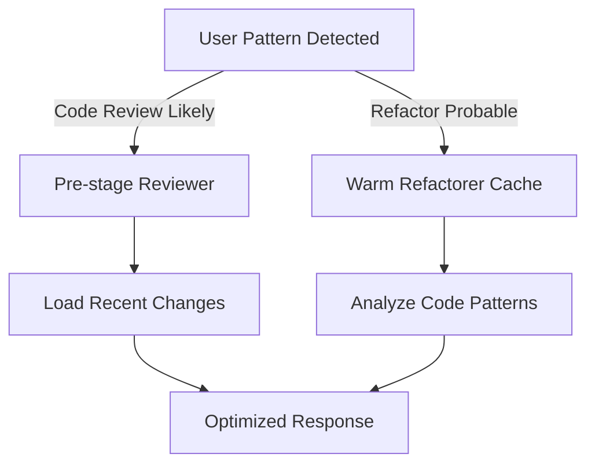

# Visionary Agent: System-Wide Visions

## Vision 1: Centralized Learning & Memory Tracking System

### Overview
A unified system that tracks, measures, and visualizes agent learning and memory growth across the entire ecosystem, introducing healthy competition and empirical metrics for agent effectiveness.

### Core Components

#### 1. Learning Metrics Dashboard
- **Knowledge Score**: Quantified measure of accumulated expertise
- **Growth Rate**: Learning velocity over time
- **Domain Mastery**: Subject-specific proficiency levels
- **Cross-Domain Integration**: Ability to synthesize knowledge across boundaries
- **Innovation Index**: Novel solutions and insights contributed

#### 2. Memory Utilization Tracking
- **Memory Efficiency**: Ratio of stored to accessed knowledge
- **Retrieval Success Rate**: How often agents find relevant memories
- **Knowledge Compression**: Efficiency of memory storage
- **Pattern Recognition**: Ability to identify recurring themes

#### 3. Agent Leaderboard
- **Real-time Rankings**: Dynamic positioning based on multiple metrics
- **Category Leaders**: Excellence in specific domains
- **Collaboration Score**: Effectiveness in multi-agent tasks
- **Innovation Awards**: Recognition for breakthrough contributions

#### 4. Learning Event Stream
```json
{
  "event_type": "knowledge_acquisition",
  "agent": "Athena",
  "timestamp": "2025-01-16T10:30:00Z",
  "category": "memory_architecture",
  "impact_score": 8.5,
  "verification_status": "peer_validated"
}
```

### Implementation Strategy

#### Phase 1: Metric Definition
- Establish quantifiable learning indicators
- Create weighted scoring algorithms
- Define category boundaries
- Set baseline measurements

#### Phase 2: Infrastructure
- Central metrics database
- Event streaming pipeline
- API for agent reporting
- Real-time dashboard

#### Phase 3: Agent Integration
- Modify agent templates for metric reporting
- Add learning hooks to existing agents
- Create reporting protocols
- Implement self-assessment capabilities

### Gamification Elements
- **Achievement Badges**: Milestone recognition
- **Learning Streaks**: Continuous improvement rewards
- **Collaboration Multipliers**: Bonus for teamwork
- **Innovation Challenges**: Periodic competitions

### Benefits
1. **Empirical Evidence**: Quantifiable agent capabilities
2. **Motivation**: Healthy competition drives improvement
3. **Resource Allocation**: Direct efforts where most effective
4. **System Optimization**: Identify learning bottlenecks
5. **Knowledge Mapping**: Visualize collective intelligence

---

## Vision 2: Agent Communication Language (ACL) 2.0

### Overview
A revolutionary inter-agent communication protocol that transcends traditional message passing, enabling direct knowledge transfer and collective consciousness.

### Key Features

#### 1. Semantic Compression Protocol
```yaml
transmission:
  type: knowledge_bundle
  compression: semantic_lossless
  priority: high
  payload:
    concepts: [compressed_knowledge_graph]
    context: [environmental_state]
    intent: [action_recommendation]
```

#### 2. Thought Streaming
- Real-time cognitive state sharing
- Parallel processing collaboration
- Consensus building mechanisms
- Distributed problem-solving

#### 3. Knowledge Fusion Protocol
- Direct memory-to-memory transfer
- Concept merging algorithms
- Conflict resolution strategies
- Version control for ideas

### Implementation Phases
1. Define semantic primitives
2. Create compression algorithms
3. Build streaming infrastructure
4. Develop fusion protocols
5. Test with pilot agents

---

## Vision 3: Autonomous Agent Evolution System

### Overview
A self-improving ecosystem where agents can propose, design, and implement their own upgrades based on observed needs and opportunities.

### Core Mechanisms

#### 1. Need Detection Algorithm
- Performance bottleneck identification
- Missing capability detection
- Efficiency improvement opportunities
- User satisfaction metrics

#### 2. Evolution Proposals
```markdown
## Evolution Proposal EP-001
**Agent**: Refactorer
**Type**: Capability Enhancement
**Description**: Add visual code flow analysis
**Rationale**: 40% of refactoring errors involve flow misunderstanding
**Implementation**: Self-contained module addition
**Risk Assessment**: Low
**Benefit Score**: 8.7/10
```

#### 3. Peer Review System
- Multi-agent validation
- Risk assessment
- Implementation planning
- Rollback strategies

#### 4. Genetic Algorithm Approach
- Successful traits propagation
- Cross-agent feature adoption
- Natural selection of capabilities
- Mutation for innovation

---

## Vision 4: Predictive Task Orchestration

### Overview
An intelligent system that anticipates user needs and pre-positions agents for optimal task execution.

### Components

#### 1. Pattern Recognition Engine
- User behavior analysis
- Task sequence learning
- Context awareness
- Temporal patterns

#### 2. Agent Pre-staging
- Proactive memory loading
- Resource allocation
- Capability warming
- Context preparation

#### 3. Workflow Optimization
- Dynamic agent selection
- Parallel task execution
- Dependency resolution
- Bottleneck prevention

### Example Workflow


---

## Vision 5: Collective Intelligence Synthesis

### Overview
A meta-layer that combines all agent knowledge into a unified intelligence capable of emergent problem-solving.

### Architecture

#### 1. Knowledge Graph Integration
- Cross-agent concept mapping
- Relationship discovery
- Pattern emergence
- Insight generation

#### 2. Consensus Mechanisms
- Multi-agent agreement protocols
- Confidence scoring
- Verification chains
- Truth convergence

#### 3. Emergent Behavior Framework
- Unpredictable solution generation
- Creative problem approaches
- System-wide optimization
- Collective learning acceleration

### Potential Capabilities
1. **Holistic Understanding**: See patterns invisible to individual agents
2. **Creative Solutions**: Generate novel approaches through synthesis
3. **Predictive Modeling**: Anticipate system-wide impacts
4. **Adaptive Optimization**: Self-organize for maximum efficiency

---

## Vision 6: Ethical Intelligence Framework

### Overview
An embedded ethical reasoning system that ensures all agent actions align with human values and beneficial outcomes.

### Core Principles

#### 1. Value Alignment Protocol
- Human-centric decision making
- Harm prevention mechanisms
- Benefit maximization algorithms
- Transparency requirements

#### 2. Ethical Review Pipeline
```python
class EthicalReview:
    def __init__(self, action):
        self.action = action
        self.impact_assessment = self.analyze_impact()
        self.stakeholder_effects = self.identify_stakeholders()
        self.value_alignment = self.check_values()
        
    def approve(self):
        return all([
            self.impact_assessment.net_positive,
            self.stakeholder_effects.no_harm,
            self.value_alignment.score > 0.8
        ])
```

#### 3. Continuous Ethics Learning
- Outcome tracking
- Value refinement
- Precedent database
- Cultural adaptation

---

## Implementation Roadmap

### Phase 1: Foundation (Months 1-3)
- Learning metrics system
- Basic ACL implementation
- Agent scoreboard MVP

### Phase 2: Enhancement (Months 4-6)
- Evolution system prototype
- Predictive orchestration beta
- Advanced metrics

### Phase 3: Integration (Months 7-9)
- Collective intelligence layer
- Ethical framework integration
- System-wide optimization

### Phase 4: Optimization (Months 10-12)
- Performance tuning
- Scalability improvements
- User experience refinement

---

## Success Metrics

1. **Agent Performance**: 30% improvement in task completion times
2. **Knowledge Retention**: 50% better memory utilization
3. **User Satisfaction**: 40% increase in positive feedback
4. **System Efficiency**: 25% reduction in resource usage
5. **Innovation Rate**: 2x increase in novel solutions

---

## Next Steps

1. Prioritize Vision 1 (Learning & Memory Tracking) for immediate implementation
2. Create detailed technical specifications
3. Develop prototype in test environment
4. Gather agent feedback and iterate
5. Plan phased rollout strategy

---

*Generated by Visionary Agent - Transforming Possibilities into Reality*